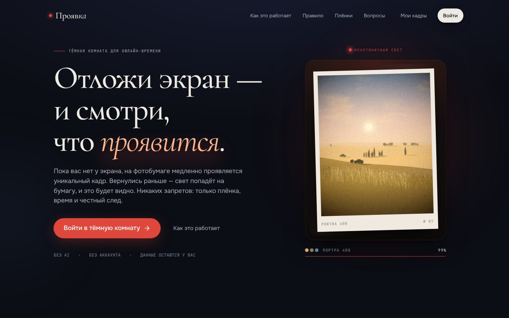
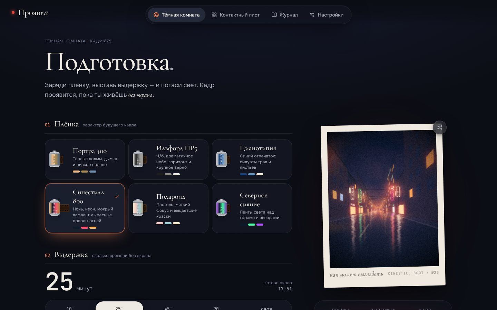
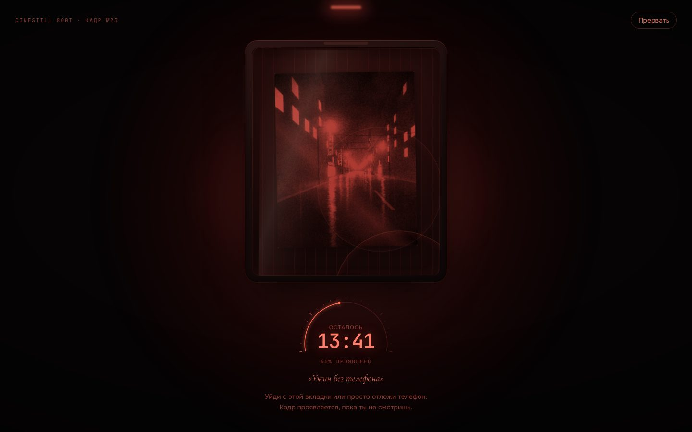
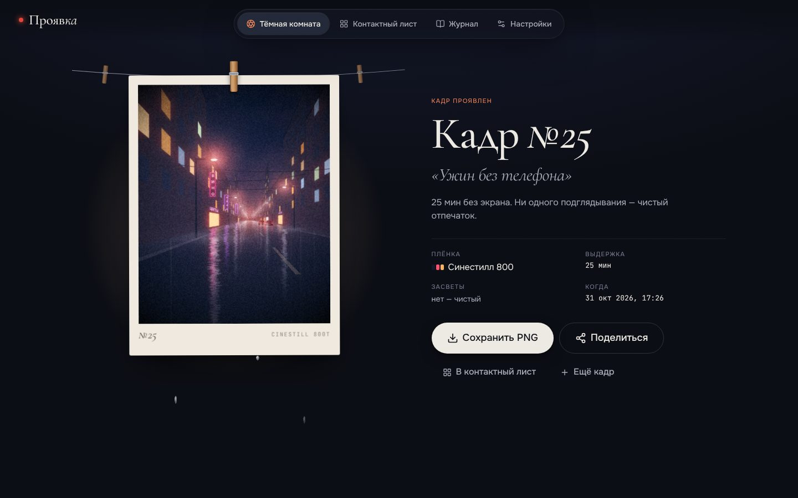
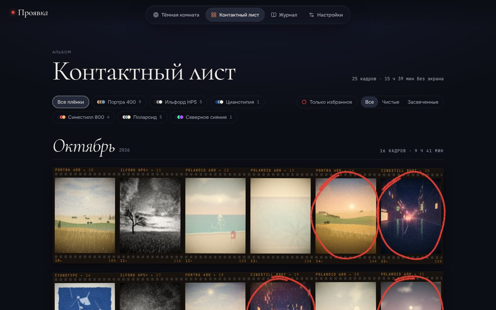
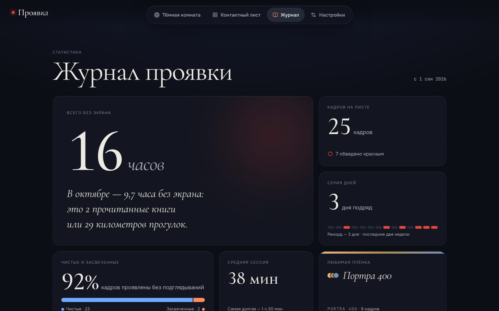

# Проявка

> Отложи экран — и смотри, что проявится.

**Проявка** — веб-приложение для времени без экрана. Вместо запретов и блокировок (Forest, Opal, Brick) здесь награда: пока вы не смотрите на вкладку, в «тёмной комнате» на фотобумаге проявляется уникальная генеративная фотография. Если вернуться раньше, дверь окажется открытой, свет попадёт на бумагу и кадр **засветится**. Он всё равно сохранится, но со следами засветки: это честный отпечаток того, как прошло время. Готовые кадры собираются в **контактный лист**, альбом вашего офлайн-времени.

Без AI, без аккаунта, без сервера. Всё работает в браузере, данные хранятся только у вас.

## Скриншоты

| Лендинг | Тёмная комната: подготовка |
|---|---|
|  |  |
| **Проявка под красным светом** | **Кадр проявлен** |
|  |  |
| **Контактный лист** | **Журнал** |
|  |  |

## Возможности

- **Тёмная комната** (`/darkroom`). Здесь выбираются плёнка, выдержка (10, 25, 45 или 90 минут либо своя) и необязательное намерение («Что будешь делать без экрана?»), которое станет подписью на кадре. Кнопка «Погасить свет» запускает сессию.
- **6 генеративных плёнок**: Портра 400, Ильфорд HP5, Цианотипия, Синестилл 800, Полароид, Северное сияние. Кадр детерминирован: одинаковые параметры всегда дают одинаковое изображение. Проявка имитирует позитивный отпечаток: сначала проступают тени, затем набираются контраст и цвет, пока бумага ещё мокрая и блестит.
- **Честные засветки.** Каждое подглядывание дольше «времени на возврат» добавляет на кадр световую утечку. Если прервать сессию, кадр сохранится засвеченным.
- **Ритуал финала**: отпечаток вешается на прищепку и дотягивает проявку. Его можно экспортировать в **PNG** в белой рамке с подписью или отправить через Web Share API. Если браузер не умеет делиться файлами, отпечаток просто скачивается.
- **Контактный лист** (`/album`): полоски плёнки по месяцам, фильтры по плёнке, избранному и засвеченным кадрам, «обвести красным». У каждого кадра есть подробная карточка-квитанция (`/album/:id`), между кадрами можно переходить стрелками на клавиатуре.
- **Журнал** (`/stats`): часы офлайн, серия дней, тепловой календарь, «часы», когда гаснет свет, любимая плёнка, доля чистых и засвеченных кадров.
- **Настройки** (`/settings`): генеративный звук тёмной комнаты на WebAudio без аудиофайлов, погода (Open-Meteo, по согласию на геолокацию) влияет на палитру кадра, уведомление о готовом кадре, время на возврат (3–30 с), темы «Ночь» и «Бумага», экспорт и импорт архива в JSON, полный сброс.
- PWA-манифест, тёмная и светлая темы, адаптивная вёрстка (проверено на 390 и 1440 px), поддержка `prefers-reduced-motion` и управления с клавиатуры.

## Как это работает: видимость и бездействие

Логика сосредоточена в `src/lib/visibility.ts` (наблюдатель) и `src/store/index.ts` (переходы состояний). Наблюдатель подключён один раз в корне приложения, поэтому сессия живёт на любой странице.

| Фаза | Событие | Что происходит |
|---|---|---|
| `developing` | вкладка скрыта (Page Visibility) или пользователь просто не трогает экран | время проявки идёт |
| `developing` | вкладка снова видима **или** пользователь взаимодействует с ней (клавиатура, тап, колесо, движение мыши > 32 px) | `openDoor()`: проявка на паузе, экран «Дверь открыта» |
| `door-open` | вкладку снова скрыли, нажали «Закрыть дверь» или 8 с ничего не трогали | `closeDoor()`: проявка продолжается |
| `door-open` | дверь была открыта **дольше `graceSeconds`** (по умолчанию 5 с) | при закрытии `peeks + 1`, на кадре появится засвет |
| любая | накоплено `developedMs ≥ durationMs` | `completeSession()`: кадр сохраняется, начинается ритуал финала |

Детали:

- **Время на возврат (grace).** Если вернуться и уйти снова быстрее, чем за `graceSeconds`, засвета не будет. Пока дверь открыта, экран показывает обратный отсчёт.
- **Первые 3 секунды после «Погасить свет»** взаимодействия не учитываются, чтобы успеть положить телефон.
- **Перезагрузка.** Сессия хранится в `localStorage` и переживает перезагрузку. Загрузка страницы посреди сессии открывает дверь ровно один раз (`pageshow` учитывается только при восстановлении из bfcache). Засвет засчитывается по тем же правилам grace.
- **Кнопка «Прервать»** и диалоги помечены `data-no-peek`, поэтому нажатие на них не открывает дверь.
- **Пока идёт сессия**, навигация скрыта и недоступна (`inert`), а любой другой маршрут перенаправляет в `/darkroom`.
- Если вкладку закрыли совсем, время всё равно идёт: проявка считается по `Date.now()`, а не по таймерам.

## Технологии

- **React 19**, **TypeScript**, **Vite 8** (Rolldown), **Tailwind CSS v4**
- **zustand** (+ `persist`) для состояния и хранения, **react-router 7** для маршрутизации, **framer-motion** для анимаций, **lucide-react** для иконок
- Canvas 2D и собственный генеративный движок без зависимостей, WebAudio, Page Visibility API, Web Share API, Notifications API, Open-Meteo
- **oxlint** для линтинга, **Playwright** для e2e (сценарий QA описан в отчёте)

Код разбит на чанки по маршрутам: лендинг входит в основной бандл, остальные страницы грузятся лениво (`React.lazy`) и подгружаются заранее в idle. Движок, React и framer-motion вынесены в отдельные кэшируемые чанки.

## Архитектура

```
src/
├── App.tsx                 маршруты, редирект в тёмную комнату во время сессии, prefetch
├── app/routes.ts           ленивые страницы (code splitting)
├── types.ts                общие доменные типы (контракт между модулями)
├── engine/                 генеративный движок (чистый TS, без React)
│   ├── index.ts            FILMS / FILM_LIST / renderFrame / exportFramePNG
│   ├── films/*.ts          6 плёнок: сцена, палитра, грейд
│   ├── pipeline.ts         сборка кадра, кэш, «проявка» по progress
│   ├── post.ts             bloom/halation, погода, засветки, зерно
│   └── export.ts           отпечаток в рамке с подписью (PNG)
├── store/                  zustand-стор: сессия, кадры, настройки, импорт/экспорт
├── lib/                    платформа: visibility (наблюдатель), weather, sound,
│                           notify, stats, format, print (экспорт/шаринг), demo
├── pages/                  Landing, Darkroom, Album, FrameDetail, Stats, Settings, NotFound
├── components/
│   ├── FrameCanvas.tsx     общий canvas кадра (очередь рендера с бюджетом времени)
│   ├── darkroom/           Setup, DevelopingRoom, DoorOpen, RevealLine…
│   ├── album/              FilmStrip, LazyFrame (IntersectionObserver), Loupe…
│   ├── stats/              Heatmap, HourClock, FilmBars…
│   ├── landing/            Hero, DevelopingDemo, HowItWorks…
│   ├── shell/              AppShell, навигация, тема
│   └── ui/                 Button, Dialog, Toast, Slider, Switch, Segmented
└── styles/theme.css        дизайн-токены (OKLCH), темы «Ночь» и «Бумага»
docs/
├── SPEC.md                 продуктовая спецификация
├── research/               исследования (см. ниже)
└── screenshots/
```

## Исследование

Продукт вырос из трёх исследований, полные тексты лежат в [`docs/research/`](docs/research/):

1. **[Рынок и концепты](docs/research/01-market.md).** AI-обёртки перестали выделяться, а «без AI, без аккаунта, данные у вас» стало преимуществом. Офлайн превратился в статус: аналоговая эстетика и усталость от подписок. Обнаружилась парадоксальная ниша: приложение, которое **награждает за то, что его закрыли**. В каждый концепт нужно закладывать карточку, которой хочется поделиться.
2. **[Конкуренты](docs/research/02-competitors.md).** Ниша фокуса плотная (Opal, one sec, Forest), но веб-приложение не может блокировать другие приложения, поэтому конкурировать в лоб бессмысленно. Свободное место — в эмоции и метафоре вместо наказаний: тёплый ритуал вместо CRM для внимания.
3. **[Дизайн-система](docs/research/03-design.md).** Арт-дирекшн Nocturne: тихий интерфейс и один «живой» визуальный объект на экране. Нейтральные цвета в OKLCH, шрифты Cormorant Garamond, Onest и JetBrains Mono. Анимации короткие на частых действиях и выразительные в редкие «моменты». Отдельно проработаны доступность и адаптивность.

## Запуск

```bash
npm i
npm run dev        # http://localhost:5173
```

Сборка и предпросмотр:

```bash
npm run build
npx vite preview   # http://localhost:4173
npm run lint       # oxlint
```

### Деплой

Это статическое SPA. Чтобы прямые ссылки вроде `/album` и `/album/:id` открывались на статическом хостинге, в репозитории есть fallback на `index.html`:

- `vercel.json` для Vercel (плюс долгий кэш для `/assets/*`);
- `public/_redirects` для Netlify и Cloudflare Pages.

## Приватность

Данные не покидают браузер: кадры, статистика и настройки хранятся в `localStorage` (`proyavka:v1`). Единственный внешний запрос — погода Open-Meteo, и только если вы включили её в настройках и разрешили геолокацию. Архив можно скачать в JSON и стереть одной кнопкой.
